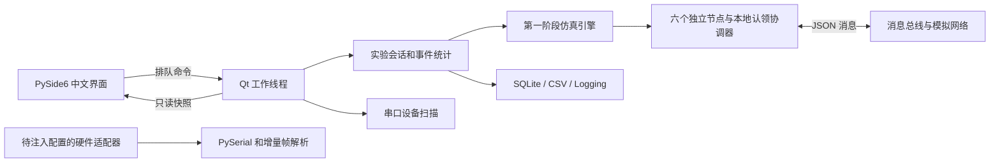

# 第二阶段上位机操作手册

## 安装和启动

在 `project` 目录使用 Python 3.11+ 创建虚拟环境。

```powershell
python -m venv .venv
.\.venv\Scripts\python.exe -m pip install -r requirements.txt
.\run.bat
```

也可执行 `python -m dashboard.main_window`。第一阶段的 `python main.py --scenario single-outage` 仍是独立 CLI 入口。

## 页面和操作

| 界面 | 操作 |
| --- | --- |
| 顶栏 | 选场景后启动新实验，暂停或继续，查看模式、时间和从 006 视角统计的节点状态 |
| 左侧节点 | 选中节点查看能力、位置、最近心跳、任务和仿真电源状态。掉电和恢复按钮控制仿真节点 |
| 协同总览 | 查看每个观察者收到的其他节点心跳状态。下方列出当前被模拟阻断的有向链路 |
| 网络实验 | 应用延迟范围、丢包和重复概率，输入分区一侧的逗号分隔节点 ID，恢复全部链路 |
| 右侧任务 | 填写 ID、类型、优先级、二维坐标、能力、截止时间及说明。发布后选择任务查看各本地视图的评分、认领、投票和重分配记录 |
| 底部日志 | 选择事件类型或搜索节点、任务 ID 及其他文本。显示最近 350 条关键事件 |
| 实验统计 | 查看在线曲线和指标，保存当前实验或选择历史实验导出 CSV |
| 硬件与感知 | 扫描本机串口，查看硬件接入状态和感知数据占位 |

### 复现实验

1. 选择「单节点失联」，点击「启动新实验」。仿真第 2 秒发布任务；第 9 秒模拟节点 001 掉线，观察 006 邻居视角由在线变为疑似失联和离线。
2. 查看 `survey` 的任务详情及底部重分配日志。默认实验里节点 002 接手，节点 001 随后恢复。
3. 选择「多节点竞争」启动新实验，观察同一轮多个节点发出正式认领及最终四票授权。
4. 如需自定义，启动「手动仿真」，填写新任务 ID 后发布。可随时选择节点操作，或在网络页调整参数。配置调整作用于后续发送，已排队投递继续按原计划到期。
5. 要结束当前实验，可启动新实验或关闭窗口。暂停会冻结仿真时钟并提交当前快照。截止时间以仿真秒计，设为 0 表示不限。

每次实验拥有独立运行 ID。实验统计中选择记录后点击「导出所选实验 CSV」。导出使用带 BOM 的 UTF-8，包含运行 ID、场景、数据来源、UTC 启动时间、仿真秒、事件、节点与事件详情。默认 SQLite 为 `data/experiments.sqlite3`，GUI 文件日志为 `logs/dashboard.log`。SQLite 保留完整事件，状态表和日志显示的是实时观察。

## 架构



仿真时钟、数据库、导出和设备扫描均在工作线程中完成。GUI 通过信号提交动作，并从快照展示各节点状态。认领仍按节点本地评分、平局裁决和四票有效租约执行。任务优先级是登记和展示字段；各任务独立竞标。第一阶段场景已提取为同一分步流程，CLI 和 GUI 直接共用。

## 协议扩展

[第一阶段 README](README.md) 定义 JSON 信封、TTL、序号和全部消息类型。第二阶段保留这些字段，任务定义增加 `task_type`、`priority`（1～5）、`deadline`（可空的绝对仿真秒）和 `task_description`。第一阶段载荷缺少这些字段时采用兼容默认值。

发布者通过原有任务定义消息附带 `cancelled: true`，接收端检查发布者身份后停止该任务。发布者通过周期重播传播取消，分区中仍持有效租约的节点可能继续执行，直到收到取消或本地租约、截止时间到期。详情显示每个节点的取消状态。截止时间到达后，节点停止评分和执行，期限内已产生且随后验证通过的结果仍可传播。

## 指标口径

- 在线节点曲线每仿真秒采样一次，使用六节点本机电源与上线状态。顶栏和左表以 006 的最近心跳视角为主，因此分区和超时窗口内两者可能不同。
- 状态变更统计包含本机和各观察者记录的状态变化。心跳超时统计以观察者进入 OFFLINE 的事件计数。
- 发送按唯一广播动作计数，接收按实际交付计数，包含副本。随机丢包率是 `packet_loss / (delivery_attempt - link_unavailable)`，隔离导致的未投递有独立事件。声明投递副本及链路阻断也独立记录。
- 认领成功率按有认领的任务轮次计算，分子是出现执行者的轮次。额外认领是每轮不同正式认领者数量减一后的合计。
- 故障检测用模拟掉电至首次观察者判离线的间隔；重分配用该次掉电至首次记录新归属的间隔。界面列出样本数量和均值。当前没有 RTT 探测数据。

## 硬件接入

`SerialManager` 扫描、打开、读取、写入和关闭串口。所有串口参数由 `SerialSettings` 明确传入。`SerialProtocol` 接收任意字节分片，保留未消费尾部，并限制缓存。接入方通过 `FrameRules` 提供拆帧、完整性校验及消息编解码。生产环境应在工作线程轮询，并处理解码异常。连接状态从 `DISCONNECTED` 经 `VERIFYING`，只在注入的真实通信校验成功后变为 `CONNECTED`。串口 I/O 断开时适配器关闭资源并传播异常。

待确认信息集中在 `hardware/device_config.json`，包括 STM32 串口参数、帧边界、校验和验证握手，以及 E22/E34 各自的工作模式、引脚接线、频道和地址等空中配置。当前 GUI 开放扫描。生产编解码器、真实握手、硬件模式联调及真实传感器显示待规格与设备验证。感知继续沿用第一阶段的 `SensorData`，无来源时显示「暂无设备数据」。
